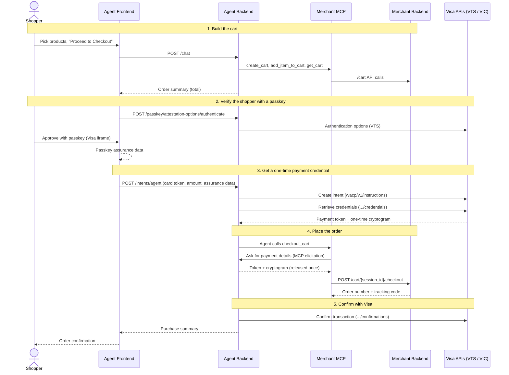

# Architecture: How Checkout Works

This page explains how the five services in this repo work together when a shopper buys something through the AI shopping agent. For setup, see [README.md](README.md); for a click-through of the app, see [USER_GUIDE.md](USER_GUIDE.md).

## The services

| Service | Port | Role in checkout |
| --- | --- | --- |
| `reference-agent-frontend` (React) | 3000 | Shopping chat UI, card picker, and passkey prompt (Visa Payment Passkey iframe/popup). |
| `reference-agent-backend` (FastAPI) | 8000 | Runs the AI agent (LangGraph), talks to Visa APIs (VTS / VIC) and records intents, mandates and transactions. |
| `reference-merchant-mcp` (Express) | 8002 | MCP tool server: exposes the store's cart and checkout as tools the agent can call. |
| `reference-merchant-backend` (FastAPI) | 8001 | The store: products, carts and orders (SQLite). |
| `reference-merchant-frontend` (React) | 3001 | Traditional storefront where a person checks out by typing in a card (no agent, no Visa APIs). |

Each service-to-service call carries a shared secret in an `X-Api-Key` header: `AGENT_API_KEY` (frontend → agent backend), `MCP_API_KEY` (agent backend → MCP server) and `MERCHANT_API_KEY` (MCP server or storefront → merchant backend).

## Agentic checkout, step by step

1. **Build the cart.** The shopper chats with the agent and picks products. On "Proceed to Checkout", the agent backend's AI agent uses the MCP tools `create_cart`, `add_item_to_cart` and `get_cart`, which call the merchant backend's `/cart` API, and returns an order summary.
2. **Verify the shopper.** The shopper chooses a saved card and clicks "Verify Identity & Continue". The agent backend fetches authentication options from Visa Token Service, and the frontend opens Visa's passkey page (`sbx.vts.auth.visa.com`) where the shopper approves with their device passkey.
3. **Get a one-time credential.** The frontend sends the card's token ID, the amount and the passkey result to `POST /intents/agent`. The agent backend creates a purchase intent with Visa Intelligent Commerce and retrieves a payment token plus a one-time cryptogram for this purchase. The real card number is never used.
4. **Place the order.** The agent backend tells the agent to `COMPLETE CHECKOUT`. The agent calls the MCP tool `checkout_cart`, which asks the agent backend for payment details through MCP form elicitation. The agent backend hands over the token and cryptogram once only (a one-shot latch under a lock), then the MCP server calls `POST /cart/{session_id}/checkout` on the merchant backend, which validates the details, runs a mock payment and creates the order.
5. **Confirm.** The agent backend tells Visa whether the purchase was approved or declined (with the merchant order ID), saves the transaction status and returns the purchase summary to the shopper.

## Traditional storefront checkout

The merchant frontend (port 3001) skips the agent and Visa entirely: the shopper types their card details on the checkout page, and the storefront calls the same `POST /cart/{session_id}/checkout` endpoint on the merchant backend directly. Payment processing in the merchant backend is a mock (it validates the card format, then always approves).
